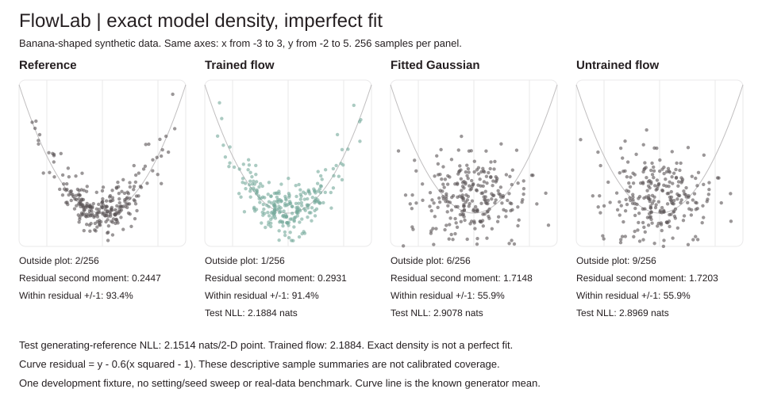
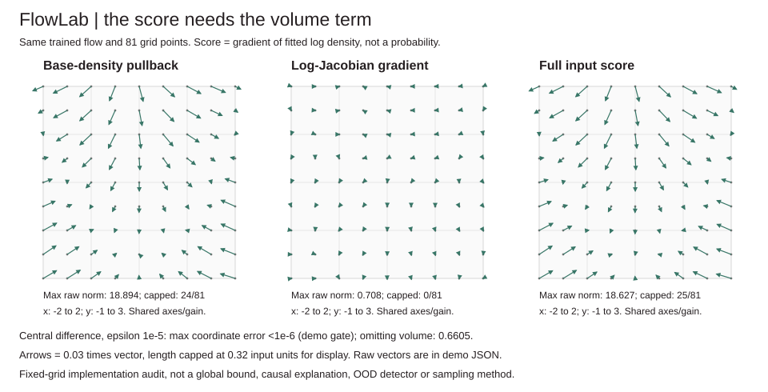
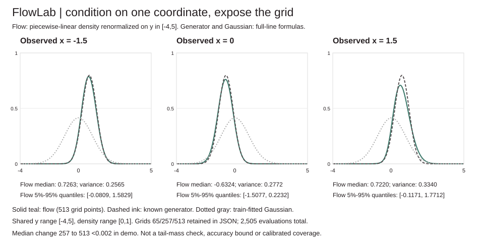
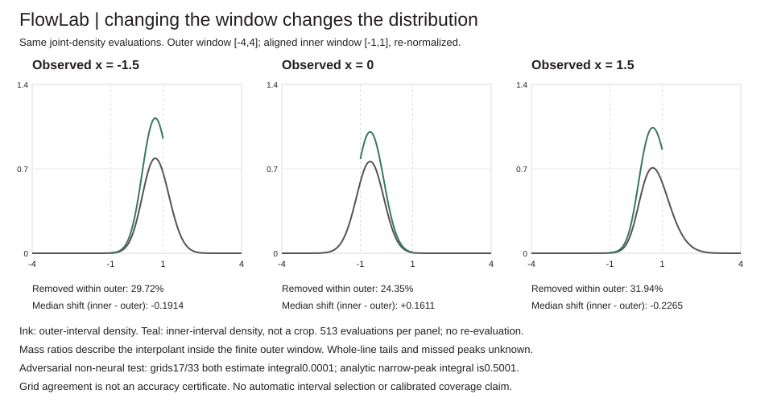

# FlowLab

FlowLab fits an affine-coupling density model to two-dimensional points. It implements the inverse, model log density and likelihood gradients without runtime dependencies, then compares the fitted model with an untrained flow and a train-fitted full-covariance Gaussian.

The same model supports input-score gradients, finite-interval conditional slices and aligned-window sensitivity checks. [DESIGN.md](DESIGN.md) defines each calculation and its numerical limits. Conditional grids are approximations; agreement between two grids does not establish accuracy.



## Run offline

```sh
python -m unittest discover -s tests -v
python -m flowlab demo > /tmp/flow-demo.json
python examples/render_demo.py /tmp/flow-demo.json --check
python examples/render_score.py /tmp/flow-demo.json --check
python examples/render_conditional.py /tmp/flow-demo.json --check
python examples/render_windows.py /tmp/flow-demo.json --check
python -m flowlab train examples/points.json /tmp/model.json --updates 1000
python -m flowlab score /tmp/model.json examples/points.json
python -m flowlab gradient /tmp/model.json examples/points.json
python -m flowlab conditional /tmp/model.json --axis 0 --value 1.5 --low -4 --high 5 --grid-size 257
python -m flowlab windows /tmp/model.json --axis 0 --value 1.5 --low -4 --high 4 --grid-size 513 --inner-start 192 --inner-end 320
python -m flowlab sample /tmp/model.json --count 128 --seed 19
```

Python 3.10+, standard library only. No GPU, account, downloaded data, pretrained weights, paid API or external runtime dependency. The full demo takes about four seconds on the development machine; hardware/Python affect runtime. The checked-in small point list is a CLI smoke example, not the training dataset used below.

## Model and numerical contract

Four alternating affine-coupling layers map data x to standard-normal latent z. Each layer keeps one coordinate a and transforms the other b:

```
y_a = x_a
y_b = x_b * exp(s(x_a)) + t(x_a)
log_abs_det = s(x_a)
x_b = (y_b - t(y_a)) * exp(-s(y_a))
log p_X(x) = log p_Z(f(x)) + sum(log_abs_det)
```

A shared 1 -> tanh(12) -> 2 conditioner produces raw scale and shift. Scale is bounded as `tanh(raw_scale)` by default; translations and data are not clipped. Masks alternate which coordinate is held fixed. The demo has 200 learned parameters, manual backpropagation and minibatch Adam. Sampling draws standard-normal latents and applies inverse layers in reverse order, returning samples from the **fitted model**, not guaranteed samples from the true distribution.

The log density is the analytic change-of-variables density of this invertible model, evaluated with ordinary floating-point arithmetic. "Exact" does not mean an exact fit, exact arithmetic, globally optimized training or certified numerical accuracy for arbitrary extreme inputs. Nonfinite states/densities fail rather than being clipped. [DESIGN.md](DESIGN.md) spells out gradients, schema, bounds and limitations.

## Measured development fixture

Independent u,v ~ N(0,1), then `x=u`, `y=0.5*v+0.6*(u*u-1)`. This is a smooth banana-shaped density with a known reference likelihood. 1,024 training points (seed 53), 512 fresh test points (seed 59); flow seed 11, training-draw seed 12, 2,000 updates, batch 32, learning rate 0.003. Final checkpoint, no validation or test-based selection. No architecture, schedule or seed sweep was run. The data and outputs were inspected during development, so this is not an untouched benchmark.

| Density | Train NLL, nats/2-D point | Test NLL, nats/2-D point |
| --- | ---: | ---: |
| Trained flow | 2.146052 | 2.188408 |
| Same untrained flow | 2.811894 | 2.896854 |
| Train-fitted full-covariance Gaussian | 2.808904 | 2.907770 |
| Known generating density, report-only reference | 2.136111 | 2.151426 |

The Gaussian fits both means and the complete 2x2 maximum-likelihood covariance on training data only. It is not an intentionally unfit standard-normal control. The untrained flow uses the same initial parameters. These are descriptive fixture comparisons, not a causal decomposition or a general model ranking.

All 256-sample arms use sample seed 19 except the fresh generator reference (seed 61). Trained/generated curve-residual second moments are **0.293054 / 0.244743**; untrained/Gaussian are **1.720324 / 1.714797**. Fractions with absolute residual <=1 are **91.41% / 93.36% / 55.86% / 55.86%** in that order. The known population residual second moment is 0.25. These are sample summaries, not calibrated probability coverage or a full distribution test. Raw points and means are in demo JSON.

Across 512 test points, the maximum forward/inverse reconstruction or opposing-logdet residual is **1.7763568394002505e-15** on the development run. That is an implementation audit on those inputs, not a global error bound. The trained model remains worse than the known generating density on this test set; likelihood fidelity and sample fidelity are different checks.

## Input score, with the missing-term trap exposed



`Flow.input_score(point)` returns the analytic input gradient of **fitted log density**, its base-density pullback and log-Jacobian gradient separately. Weights stay fixed. The `gradient` CLI returns all three vectors plus log density, for 1-256 input rows. This is separate from `score`, the existing log-density command.

For `log p_X = log p_Z(f(x)) + L(x)`, the score is `J_f(x)^T (-f(x)) + grad L(x)`. Merely pulling back the normal score drops a real term when scales depend on input. The same trained fixture on a fixed 9x9 grid, x=-2..2 and y=-1..3, has maximum coordinate discrepancy **1.19e-9** against central differences (epsilon 1e-5). Dropping the logdet gradient gives **0.660545** maximum coordinate discrepancy. Both gates run in the demo. These are implementation checks, not a global derivative error bound or an ablation of learning quality.

The figure uses one shared gain and a disclosed display-length cap, with raw vectors and per-panel capped counts. It does not simulate ascent paths or generate samples. Gradients depend on coordinate units; they are not probabilities, feature importances, causal effects, likelihood ratios or an out-of-distribution detector. Direction points toward local increase, not necessarily a global mode or the data manifold. Closed-form constant-affine and variable-scale cases independently check the volume contribution; both coordinates/components are finite-differenced through 1/2/3/8-layer networks.

## Conditional slices: a grid is not an exact conditional



`conditional_slice(flow, fixed_axis, fixed_value, low, high, grid_size)` and the `conditional` CLI evaluate the joint log density along one free coordinate. Log-max subtraction avoids underflow from a large shared log-density offset. The trapezoid rule normalizes a **piecewise-linear density on the supplied finite interval**; moments integrate that interpolation analytically, CDF integrates each segment, and quantiles invert it by bounded bisection. JSON retains every grid point, original joint log density, normalized density, CDF, requested quantiles, moments and actual model-call count. Both fixed-axis choices work. No unreported adaptive search.

The same trained model, observed x=-1.5/0/1.5, free y interval[-4,5] and grids65/257/513 use **2,505 model evaluations** in total. On the finest grid:

| Fixed x | Flow median | Flow variance | Flow 5%-95% quantiles | Median change257 to513 |
| ---: | ---: | ---: | --- | ---: |
| -1.5 | 0.726272 | 0.256504 | [-0.080939,1.582895] | 0.00000649 |
| 0 | -0.632395 | 0.277220 | [-1.507665,0.223181] | 0.00000070 |
| 1.5 | 0.722021 | 0.334000 | [-0.117114,1.771246] | 0.00001986 |

The known generator's full-line conditional means are 0.75/-0.6/0.75, each with variance 0.25. The train-fitted Gaussian's full-line conditional means are 0.005363/0.019952/0.034542, with variance 0.924248. Reference curves are clearly labeled full-line formulas; the flow curves are interval-renormalized approximations. These descriptive development slices do not establish calibrated coverage or model quality elsewhere. Original training and earlier audit outputs are unchanged.

Grid refinement checks only sensitivity to these grid sizes **inside the same interval**. It cannot measure missing tail mass or guarantee accuracy; two grids can miss the same narrow peak. The returned log slice integral is an approximate integral of joint density over this interval, with density units for the fixed coordinate. It is not an event probability, exact marginal likelihood or tail probability. A continuous exact-coordinate condition has probability zero; the density slice defines the conditional approximation. Narrower intervals change the distribution, not just its displayed crop.

All bounds are validated before model evaluation: fixed axis0/1, fixed value[-100,100], interval endpoints[-100,100] with width>=1e-6, grid2-513, and1-33 requested quantiles in[0,1]. Nonfinite joint scores fail. Default quantiles are.05/.5/.95, with endpoints and duplicate/unsorted requests supported. Uniform and linear-density formulas, normal/affine references, explicit truncation, refinement, log offsets+/-10000, monotone CDF/normalization, no mutation, preflight call budgets and CLI errors are tested.

## Window sensitivity and a grid-agreement counterexample



`window_audit` and the `windows` CLI evaluate one outer grid, then reuse a contiguous, index-aligned subgrid for an inner window. They return both full interpolated distributions, the inner/outer segment-area ratio, the removed fraction **within the finite outer window**, and inner-minus-outer median shift. No second round of model evaluations and no adaptive choice of bounds. Shared sampled heights make these mass ratios internally consistent for this interpolant; they do not make the interpolant accurate.

Same trained flow, outer[-4,4],513 points; inner indices192..320 give[-1,1],129 points. Each row costs513 model evaluations, **1,539 total**, not513+129 per row:

| Fixed x | Removed interpolated fraction within outer | Inner-minus-outer median | Inner median | Inner variance |
| ---: | ---: | ---: | ---: | ---: |
| -1.5 | 0.297166 | -0.191406 | 0.534865 | 0.119903 |
| 0 | 0.243537 | +0.161078 | -0.471317 | 0.144531 |
| 1.5 | 0.319448 | -0.226502 | 0.495517 | 0.127310 |

This measures how renormalizing on a narrower window changes the fitted conditional approximation. The removed fractions are **not whole-line tail probabilities**. They exclude everything outside[-4,4] and may miss structure between grid points. The inner curve is not a cropped version of the outer density: it has a new normalizer and new quantiles. Bounds and indices remain user-selected, never optimized to make results look stable.

The demo also supplies a non-neural adversarial integrand, `.0001 + .5*NormalPDF(y; mean=.015625, sd=.0001)` on[0,1]. Both 17- and 33-point grids miss the same narrow peak and report integral 0.0001, while the analytic normal-CDF reference gives 0.5001. Both grids' interpolated means are 0.5 despite the actual mean being near 0.01572. These 50 callback evaluations are separate from the 1,539 trained-model calls. The constant component is a density floor **in this artificial integrand only**, not a clipping rule for flow inference. This demonstrates why grid agreement cannot certify conditional accuracy; it is not evidence that this trained model has the same missed peak.

Tests verify aligned reuse/counts, constant-density offset invariance, exact full-window identity, nested mass monotonicity, the normal erf reference, zero-call index rejection, CLI limits and the missed-peak counterexample. Original training, density, score and conditional-grid outputs remain unchanged. Fixed finite windows cannot establish calibrated coverage, full-line normalization or safe automatic bounds.

## Audits

45 tests include every parameter of tiny one/two/three-layer flows by central finite differences, an independent finite-difference full Jacobian determinant, both inverse directions, constant-affine density, logdet sign, standard-normal identity, midpoint density integration of a small near-identity model, strict serialization, bounds, no mutation and CLI. The quadrature test is a finite-grid sanity check, not a general normalization proof; the bijective change-of-variables construction supplies the model's mathematical normalization.

CI tests Python 3.10-3.13, trains the actual fixture and checks all four reproduced SVGs on 3.11. Figures use shared axes and expose outside-plot counts rather than silently dropping outliers.

## Limits

Only continuous 2-D points, 1-8 layers and hidden width 1-32. No image model, dequantization, multiscale architecture, batch normalization, residual conditioner, classifier, out-of-distribution detector or production guarantee. Bounded scales limit per-layer dilation but do not bound translation, all input derivatives or every composite condition number. Artifacts save inference weights/settings, not optimizer state, and do not support exact training resume. No privacy or anomaly-detection claim. Density values may exceed 1; densities are not discrete point probabilities and NLL units depend on coordinate units.

## Source credit

Independent educational implementation of **Dinh, Sohl-Dickstein and Bengio (2017), [Density estimation using Real NVP](https://arxiv.org/pdf/1605.08803v3.pdf)**, especially change of variables Eq.2-3, affine coupling/inverse Eq.4-9 and alternating couplings Section3.5. Source read for mathematics; no copied code or pretrained weights. The paper's image architecture and benchmark results are not reproduced here.

MIT license.
